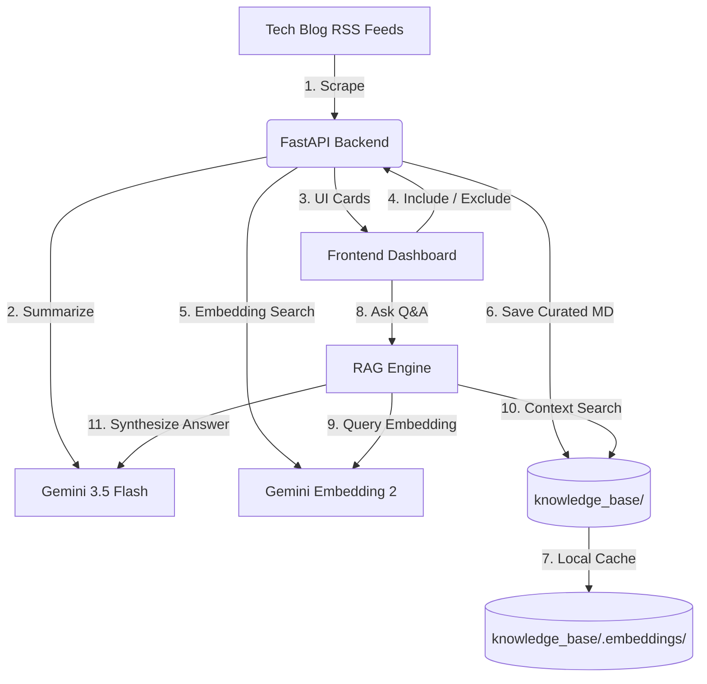

# Tech Blog Scanner & Curated Knowledge Repository Agent

A modern, agentic web application built using the Google ADK Python SDK and Gemini 3.5 Flash that scans technology blogs (Google, Meta, Netflix, AWS), curates an extensive summary repository, and features a local semantic Q&A (RAG) search panel.

This project is prepared as a capstone project for the Kaggle Vibe Coding Agents competition.

---

## Architecture Overview



---

## Key Features

1. **Tech Blog Feed Scraper**: Downloads and parses RSS/Atom feeds dynamically from major tech blogs.
2. **AI-Powered Curation**:
   - Generates 2-3 sentence summaries for scanning.
   - Generates structured, extensive markdown summaries (Executive Summary, Highlights, Implications) upon approval.
3. **Semantic Similarity Linking**: Computes vector similarity using `gemini-embedding-2` to auto-link related articles inside the repository.
4. **Local Embedding Cache**: Caches document embeddings in `knowledge_base/.embeddings/` to make similarity comparisons near-instant.
5. **Persistent Exclusions**: Mark articles to be excluded, permanently filtering them from future feed scans.
6. **Local RAG Chat Panel**: Search and ask questions over the curated summaries, returning synthesized answers with clickable source citations.
7. **Zinc Dark-Mode GUI**: Clean HTML/CSS/JS frontend featuring responsive tab views, loading skeletons, and smooth card transitions.

---

## Project Structure

```
blog-scanner-agent/
├── app/
│   ├── agent.py          # CLI agent workflow and logic
│   ├── fast_api_app.py   # FastAPI web server and REST API endpoints
│   ├── tools.py          # Scraper, similarity search, and repository tools
│   └── app_utils/        # Telemetry and ADK utilities
├── frontend/
│   ├── index.html        # Main dashboard UI structure
│   ├── index.css         # Custom dark zinc styling system
│   └── index.js          # Tab navigation, API fetching, and UI transitions
├── knowledge_base/       # Target directory for curated markdown summaries
│   └── .embeddings/      # Local document embedding JSON cache
├── tests/                # Unit, integration, and FastAPI E2E tests
├── config.json           # Blogs list and knowledge base path configuration
└── pyproject.toml        # Project dependencies (managed via uv)
```

> **Config location:** `config.json` is read from the working directory by default.
> Set `BLOG_SCANNER_CONFIG` (e.g. `/code/data/config.json`) to keep it on a mounted
> volume so sources added in the dashboard survive container rebuilds. If that file
> doesn't exist yet, it is seeded from the bundled `config.json` on startup.
>
> Excluded articles live in `excluded.json` in the working directory. Set
> `BLOG_SCANNER_EXCLUDED` (e.g. `/code/data/excluded.json`) to keep them on a mounted
> volume. Mount the directory, not the file: writes replace the file atomically,
> which fails on a single-file bind mount.

---

## Getting Started

### Prerequisites
- **Python 3.12+**
- **uv**: Python package manager - [Install](https://docs.astral.sh/uv/getting-started/installation/)
- **GCP Project**: Authenticated Google Cloud account with Gemini API access.

### Setup
1. Authenticate with Google Cloud Application Default Credentials (ADC):
   ```bash
   gcloud auth application-default login
   ```
2. Install dependencies:
   ```bash
   uv sync
   ```

### Running the Web GUI Dashboard
1. Start the FastAPI local server:
   ```bash
   uv run python -m app.fast_api_app
   ```
2. Open your web browser and navigate to:
   ```
   http://localhost:8000/dashboard
   ```
3. Use the **Scanner** tab to discover and curate articles, the **Ask Repository** tab to chat with your knowledge base, and the **Saved Articles** tab to read or delete summaries.

### Running CLI Workflow
If you prefer running via the terminal console, start the ReAct workflow directly:
```bash
uv run agents-cli run "Scan tech blogs"
```

---

## Testing & Quality Control

The project has complete test coverage across unit, integration, and E2E endpoints:

- **Run all tests**:
  ```bash
  uv run pytest
  ```
- **Run formatting & lint quality checks**:
  ```bash
  uv run ruff format . && agents-cli lint
  ```
